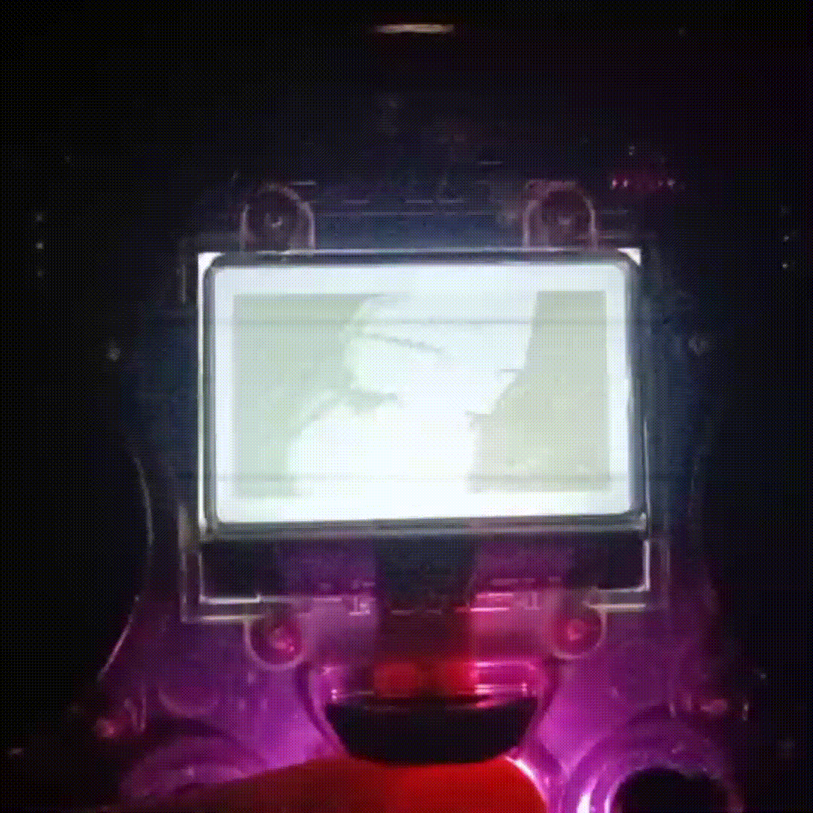
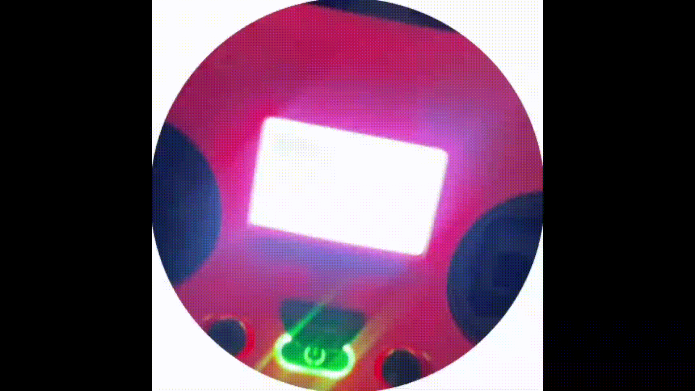

# EdgeTX Studio

  
  

EdgeTX Studio turns images and animations into monochrome assets and a Lua telemetry screen script for EdgeTX radios. Choose your transmitter, preview the result at its display resolution, adjust image processing or animation timing, then export the files for your radio's SD card.

## Use EdgeTX Studio

1. Select your transmitter from the menu in the top bar. This sets the export dimensions.
2. Choose one of the workflows below to add an image or animation.
3. Check the preview and adjust the available image, playback, or effects settings.
4. Select **Export project** and choose **Build ZIP archive**. The ZIP contains split 1-bit BMP image files and `SCRIPTS/TELEMETRY/studio.lua`.
5. Copy the ZIP contents to the matching folders on your radio's SD card, keeping the folder structure. You can also use **Detect SD card folders** and **Upload files** when direct folder access is available in your browser.
6. On the radio, open the EdgeTX telemetry screen configuration and assign `studio.lua` as a telemetry screen script.

### Static image

1. Open the **Image** tab and drop or browse for a PNG, JPG, BMP, or WebP image.
2. Adjust brightness, contrast, threshold, scale, and crop to fit the preview. Enable dithering to preserve more tonal detail, or invert colors if needed.
3. Export the project. A single still image is packaged as left and right BMP halves in the `IMAGES` folder.

### GIF

1. Open the **Animation** tab and drop or browse for an animated GIF. Its frames are imported into the timeline with their frame delays.
2. Press **Play preview** to review it. Adjust playback speed, loop behavior, or the selected frame duration as needed. Image processing and color inversion settings are shared with the **Image** tab.
3. Export the project. Animation frames are packaged under `IMAGES/FRAMES` and used by the generated Lua script.

### Custom frames

1. Open the **Animation** tab and select **Add frames**, or drop image files into the timeline. You can add multiple PNG, JPG, BMP, or WebP files; GIFs can also be added this way.
2. Reorder frames with the up/down controls or drag them into position. Select a frame to set its duration, then use **Play preview** to check the sequence. Use **Overlay on static image** if you want the animation ink layered over an image from the **Image** tab.
3. Export the project. The ordered frames are written as split BMP files under `IMAGES/FRAMES`.

## Optional: add effects

Use the **Effects** tab to add supported animated effects to the preview and generated Lua script. Only enabled effects are included in the export.
