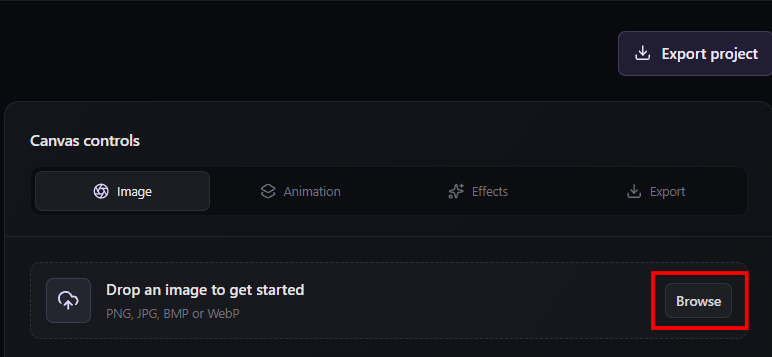
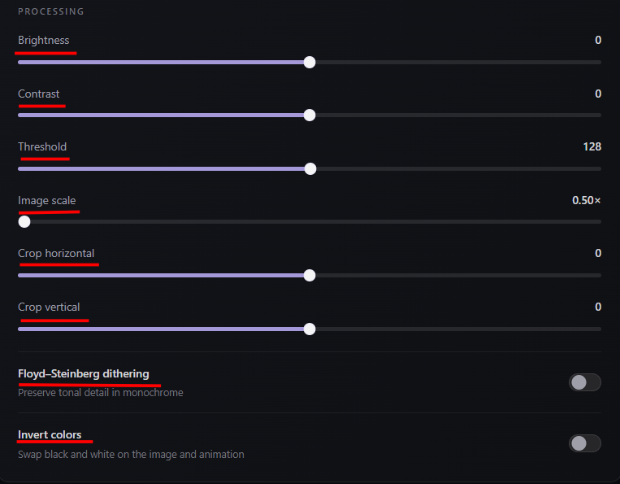
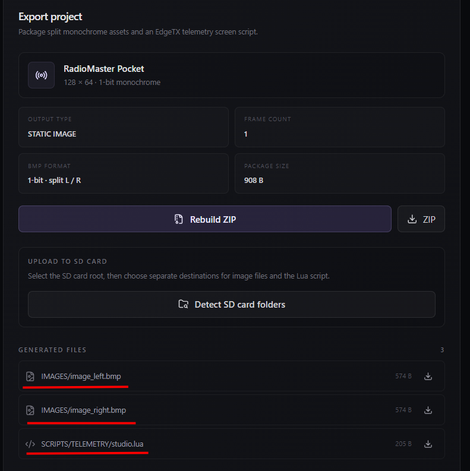
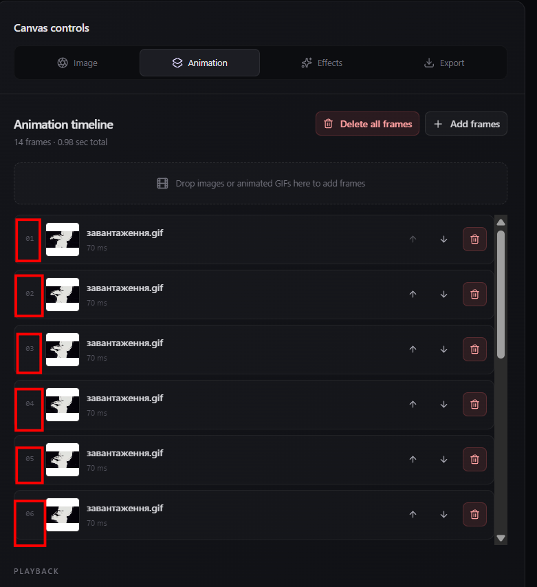
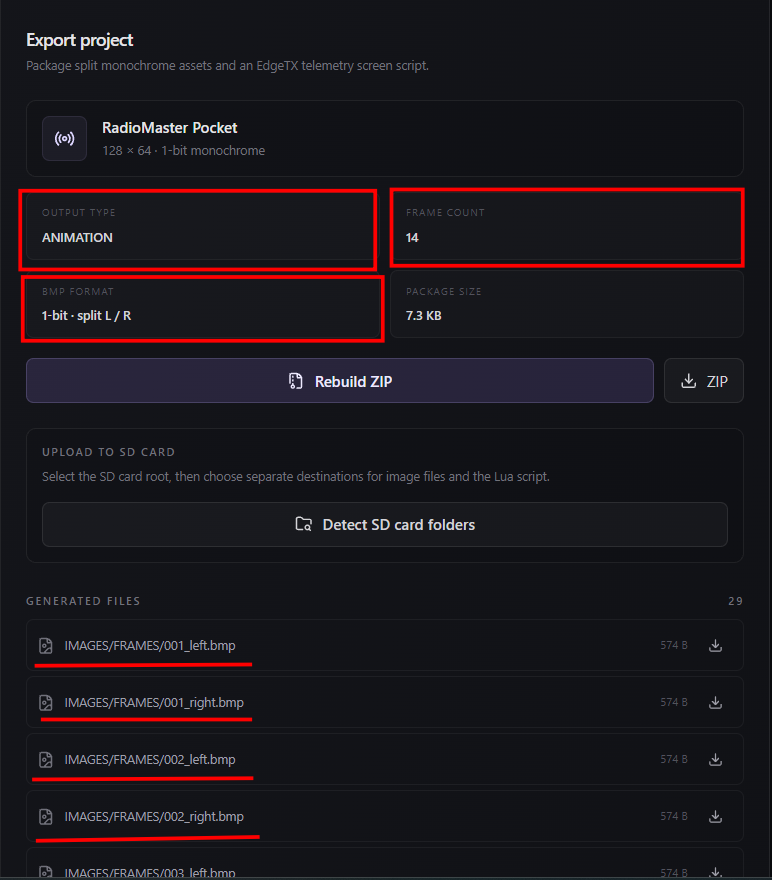
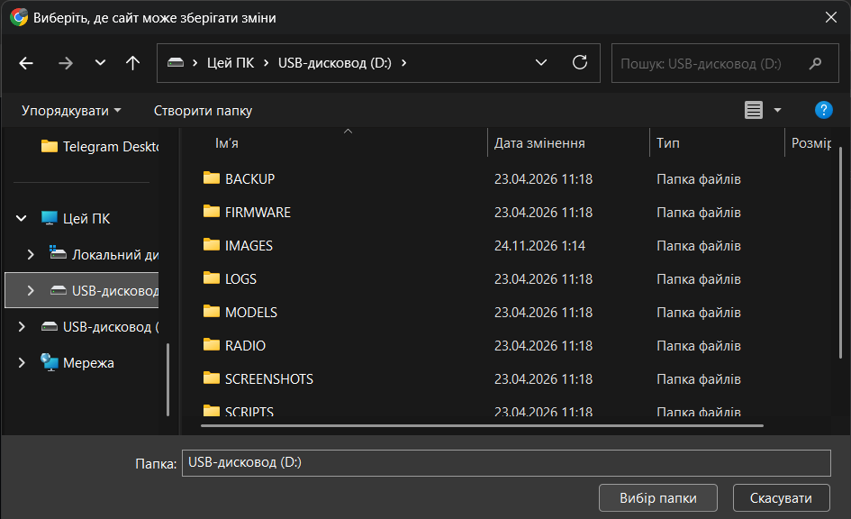
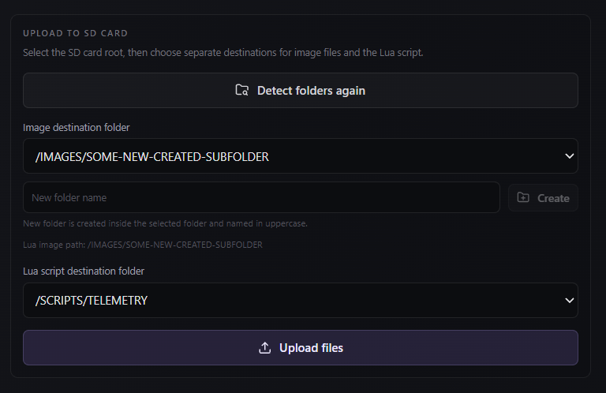
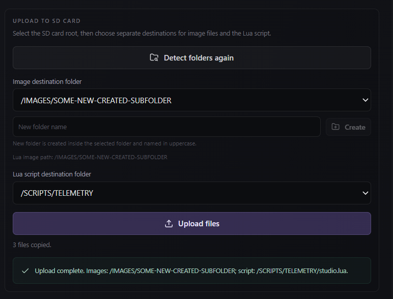
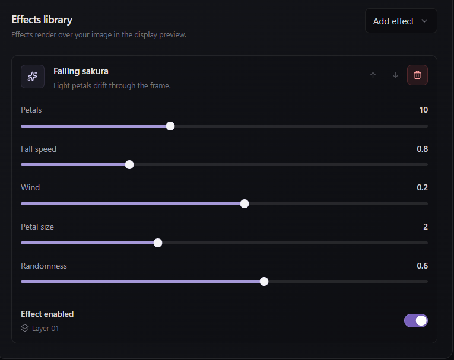

# EdgeTX Studio

  
  

EdgeTX Studio turns images and animations into monochrome assets and a Lua telemetry screen script for EdgeTX radios. Choose your transmitter, preview the result at its display resolution, adjust image processing or animation timing, then export the files for your radio's SD card.

## Use EdgeTX Studio

1. Select your transmitter from the menu in the top bar. This sets the export dimensions.
2. Choose one of the workflows below to add an image or animation.
3. Check the display preview and adjust image processing or animation settings as needed.
4. Select **Export project** and build the ZIP, or upload directly to the SD card using the instructions below.
5. On the radio, assign `studio.lua` as a telemetry screen script and check the result on your firmware.

### Static image

1. Open the **Image** tab and drop or browse for a PNG, JPG, BMP, or WebP image.

2. Adjust brightness, contrast, threshold, scale, and crop to fit the preview. Enable dithering to preserve tonal detail, or invert colors if needed.

3. Export the project. A still image is split into left and right 1-bit BMP files in `IMAGES`.

### GIF

1. Open the **Animation** tab and drop or browse for an animated GIF. Its frames are imported in GIF order with their frame delays, and preview playback starts automatically.

2. Adjust playback speed, loop behavior, or an individual frame's duration if needed. Image processing and color inversion settings are shared with the **Image** tab. Use the preview's pause control only if you want to pause playback.

3. Export the project. Frames are written in timeline order under `IMAGES/FRAMES` and played by the generated Lua script.

### Custom frames

1. Open the **Animation** tab and select **Add frames**, or drop image files into the timeline. Add multiple PNG, JPG, BMP, or WebP files; GIFs can also be added.
2. Frames start playing automatically in the order they were added. Reorder them with the up/down controls or drag them into position; export uses the resulting timeline order, just like GIF export. Select a frame to change its duration. Use **Overlay on static image** to layer the frames over an image from the **Image** tab.
3. Export the project. The ordered frames are written as split BMP files under `IMAGES/FRAMES`.

## Upload directly to an SD card

1. Connect the radio's SD card to your computer and open **Export**. Build the project first; the upload controls appear after the files are generated.
2. Select **Select SD card** and choose the SD card's root folder in the browser folder picker. This is the top-level folder containing folders such as `RADIO` and `SCRIPTS`.

  

3. Choose the image destination and Lua script destination from the folder lists. For an animation, choose the folder where you want its frames stored. The app updates the Lua image path to match the selected image folder. You can create a new image subfolder if needed.

  

4. Select **Upload files** and wait for the completion message before removing the card. The app copies the BMP files and `studio.lua` into the selected folders.

  

Direct folder access requires a secure page (HTTPS or localhost) in a desktop browser with folder picker support, such as Chrome or Edge. If the picker is unavailable, download the ZIP and copy its contents to the SD card manually, preserving its folder structure.

## Optional: add effects

Use the **Effects** tab to add supported animated effects to the preview and generated Lua script. Only enabled effects are included in the export.

